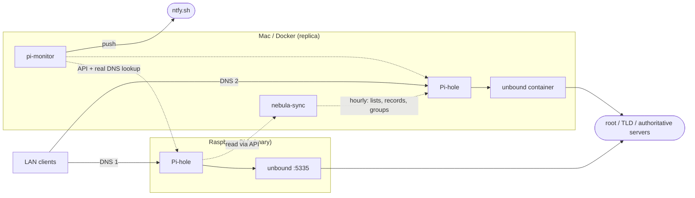

# home-dns

[](https://github.com/h-holm/home-dns/actions/workflows/ci.yml)

Highly available DNS with ad blocking for a home network: two [Pi-holes](https://pi-hole.net/),
each with its own [unbound](https://nlnetlabs.nl/projects/unbound/) as a recursive, DNSSEC-validating
resolver, so no third-party DNS provider sees your queries.

- **Primary:** a Raspberry Pi with a native install. It's the source of truth. See [`pi/`](pi/README.md).
- **Replica:** Docker containers on a Mac (OrbStack), defined in this repo's `docker-compose.yml`.
  [nebula-sync](https://github.com/lovelaze/nebula-sync) copies the primary's settings to it every hour.
- **Monitoring:** a small watchdog sends an [ntfy](https://ntfy.sh) push when either Pi-hole stops answering
  (or its resolver breaks), and another when it recovers.
- **Config as code:** the primary's settings are exported to JSON (versioned in git) and can be applied
  to a fresh Pi-hole through its API, so a rebuild doesn't depend on a backup archive.



The router hands out both addresses (DNS 1 = Pi, DNS 2 = Mac), so DNS keeps working when either one is
down. Clients don't strictly prefer DNS 1, so both must block the same things, which is what the sync is for.
Make all changes (lists, allow/deny entries, local DNS records) **on the primary**; they reach the replica
within the hour.

## Repository layout

| Path | What |
|---|---|
| `docker-compose.yml` | The replica: `pihole`, `unbound`, `nebula-sync`, `pi-monitor` |
| `unbound/pihole.conf` | Additions to the unbound image's default config |
| `monitor/pi-monitor.sh` | The watchdog (busybox `sh`, runs in plain alpine) |
| `pi/` | The primary: setup and rebuild guide, its unbound config |
| `scripts/bootstrap-pi.sh` | Sets up a freshly flashed Pi (unattended upgrades, unbound, Pi-hole). Idempotent |
| `scripts/export-pi-config.sh` | Exports the primary's settings to JSON (read-only), optionally a Teleporter backup |
| `scripts/apply-pi-config.sh` | Applies such an export to a Pi-hole (dry run by default) |
| `examples/config-export.example.json` | What an export looks like (fake data; also used by CI) |
| `.env.example` | Template for `.env`: passwords, ntfy topic, addresses, time zone |
| `local/` | **Not in this repo** (gitignored): your private overlay, see below |

### Public code, private data

Everything specific to one household stays out of this repo: secrets go in `.env`, and site data
(the real config export with your local DNS records, notes, backup locations) goes in `local/`, a
clone of a separate **private** repo. `scripts/export-pi-config.sh` writes into `local/pi/`.

| What | Where | Backed up by |
|---|---|---|
| Code, docs | this repo | GitHub |
| Lists, local DNS records, groups, clients | `local/pi/config-export.json` | your private repo |
| Passwords, ntfy topic, addresses | `.env` | a copy in your password manager |
| Full Pi-hole backups (incl. password hash) | Teleporter zips in `$BACKUP_DIR` | your normal backups |

## Setting up the replica from scratch

1. Install [OrbStack](https://orbstack.dev/) (or another Docker runtime). Give the Mac a fixed LAN address.
2. Clone this repo, and your private overlay into `local/`:
   `git clone <your private repo> local` (or just `mkdir -p local/pi` if you start fresh).
3. `cp .env.example .env && chmod 600 .env` and fill it in, or restore it from your password manager.
   Passwords: no `|` or `,` (nebula-sync uses them as separators). ntfy topic:
   `echo "pihole-$(openssl rand -hex 12)"`.
4. `docker compose up -d`. Within a minute nebula-sync copies the primary's lists and records. Check
   with `docker compose logs nebula-sync` ("Sync completed") and `dig @<REPLICA_IP> doubleclick.net`
   (→ `0.0.0.0`).
5. Subscribe to the ntfy topic in the ntfy app (server `ntfy.sh`). You get a "pi-monitor started" push.
6. In the router's DHCP settings: DNS 1 = `PI_IP`, DNS 2 = `REPLICA_IP`, nothing else (a public resolver
   as a third entry would bypass blocking). With IPv6, make sure the router doesn't also announce its
   own DNS (check a client: `scutil --dns` on macOS).

## Disaster recovery

| What broke | Get back up |
|---|---|
| **The Pi** (SD card, hardware) | Fastest: write your newest full SD-card image to a new card. Otherwise: flash Raspberry Pi OS Lite, then `sudo scripts/bootstrap-pi.sh` on the Pi, then `scripts/apply-pi-config.sh --apply` from the Mac ([details](pi/README.md#rebuilding-the-pi)). The replica serves DNS meanwhile. |
| **The Mac** | New host: steps 1–5 above. Needs this repo, your private overlay and `.env` from your password manager. The Pi serves DNS meanwhile. |
| **Both** | The Pi first (it's the source of truth), then the Mac. |
| **No Teleporter zip** | Not needed: `apply-pi-config.sh` restores lists, allow/deny entries, groups, clients and local records from the export in `local/`. |

## Everyday commands

| Task | Command |
|---|---|
| Status | `docker compose ps` |
| Logs | `docker compose logs -f --tail 100 pihole` (or `unbound`, `nebula-sync`, `pi-monitor`) |
| Sync now | `docker compose restart nebula-sync` (it syncs at start) |
| Export the primary's settings | `scripts/export-pi-config.sh`, then commit in `local/` (add `--teleporter` for a full backup) |
| Compare a Pi-hole with the export | `scripts/apply-pi-config.sh` (dry run; `--target URL` for another Pi-hole) |
| Update Pi-hole | see below |
| Update unbound / nebula-sync | change the image tag, `docker compose up -d <service>` |

## Updating Pi-hole (keep both on the same versions)

1. The primary's web UI (or `GET /api/info/version`) shows which Core, Web and FTL versions are available.
2. Find the `pihole/pihole` image tag with exactly those versions: the release notes list them, or check
   inside the image (`git -C /etc/.pihole describe --tags`, `git -C /var/www/html/admin describe --tags`,
   `pihole-FTL --version`). Read the release notes for breaking changes.
3. Back up: `scripts/export-pi-config.sh --teleporter`.
4. **Replica first, as a canary:** change the tag in `docker-compose.yml`, `docker compose up -d pihole`.
   Check that it gets healthy, blocks, and that a sync from the (still older) primary works
   (`docker compose restart nebula-sync`).
5. **Then the Pi:** `sudo pihole -up` over SSH, then `pihole -v` and `pihole status`. Its DNS restarts for a
   few seconds; clients use the replica meanwhile.
6. Compare: `scripts/export-pi-config.sh`, `git -C local diff`, and the replica's web UI.

## Alerts

Every 60 s pi-monitor checks both Pi-holes: the web API (`/api/info/login` must say `"dns":true`)
and a real DNS lookup through each, which also catches a broken unbound. After 3 failed checks in a
row it sends an ntfy push (high priority), and another one when it recovers. Pushes that can't be
delivered are retried every round, so an alert can be late but isn't lost. A quiet "pi-monitor
started" push means the Mac (re)started.

Test it without touching anything (pushes get a `[TEST]` prefix):

```sh
docker compose run --rm --no-deps -e TITLE_PREFIX="[TEST] " -e PI_URL=http://127.0.0.1:9 \
  -e INTERVAL=3 -e FAILS_BEFORE_ALERT=2 pi-monitor sh -c 'timeout 15 sh /monitor/pi-monitor.sh'
```

## Design notes

- **The primary is the source of truth.** nebula-sync copies from it selectively (`FULL_SYNC=false`):
  lists, allow/deny entries, groups, clients and the DNS section with local records. Never DHCP: two DHCP
  servers on one LAN would break the network. Settings that must differ on the replica are excluded from
  the sync and fixed with `FTLCONF_*` variables (which Pi-hole enforces at every start):
  `dns.upstreams` (the replica's own unbound), `dns.listeningMode=ALL`, `dns.rateLimit.count=0`.
- **Port mapping bound to one LAN IP**, not host networking. With OrbStack, Pi-hole sees every client
  as one address in either mode (traffic goes through a userspace proxy), so the per-client rate limit
  is off on the replica (it would throttle the whole LAN during a failover), and per-client group rules
  only fully apply on the primary. Binding to one IP makes UDP replies come from the address the client
  asked, on a host with both Ethernet and Wi-Fi on the same subnet.
- **unbound is its own container with a fixed IP**, not inside pihole's network namespace: if pihole
  restarted on its own, a container sharing its namespace would be left without network. It uses the
  image's default config (which follows Pi-hole's unbound guide) plus `unbound/pihole.conf`, so it
  behaves like the Pi's unbound (`pi/unbound/`).
- **No system-wide VPN on the replica host.** A VPN client can intercept DNS and stop containers from
  reaching LAN devices, which breaks the sync, the monitor and unbound.
- **Export and apply are symmetric.** The export leaves out counters that change on every gravity run, so
  `git diff` shows only real changes. The apply step adds missing groups, lists, domains and clients
  (mapping group IDs by name) and sets differing DNS keys; it never deletes, so it's safe to rerun.

## Adapting it to your network

Everything site-specific is in `.env`: the two addresses (`PI_IP`, `REPLICA_IP`), the replica's web port,
passwords, the ntfy topic, the time zone and the backup directory. The replica runs anywhere Docker runs;
on Linux you could use host networking and get real client IPs. CI checks the scripts with shellcheck,
validates the configs (`docker compose config`, `unbound-checkconf`), starts the replica's Pi-hole and
unbound and tests resolution and blocking, and round-trips the example export through
`apply-pi-config.sh`.

## License

[MIT](LICENSE)
